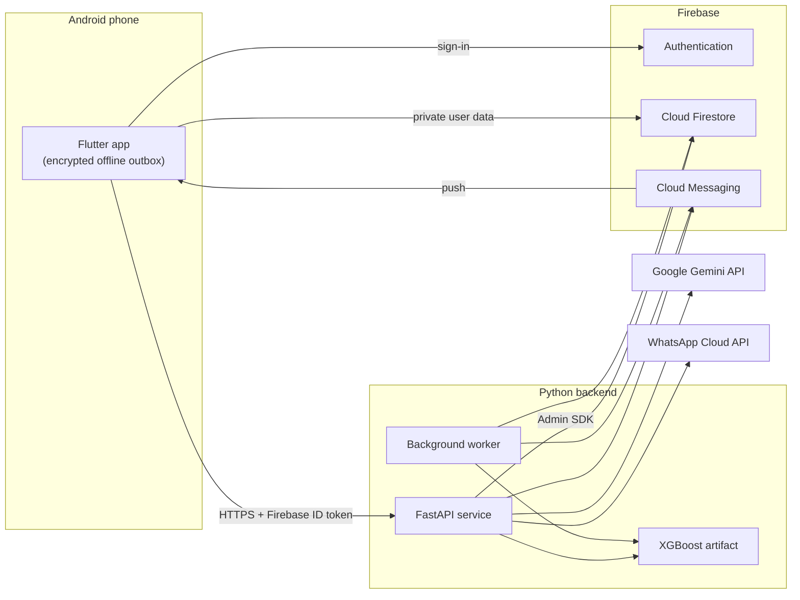
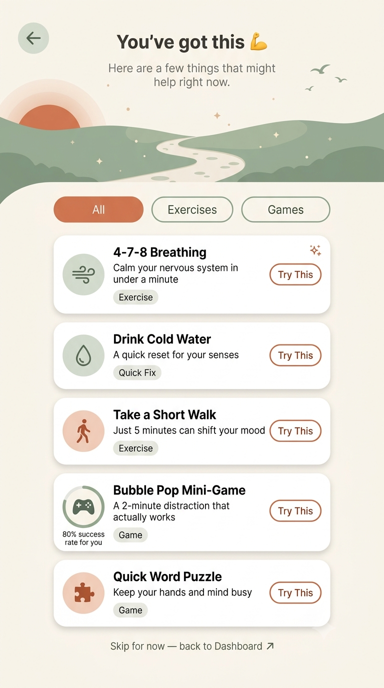

<div align="center">


# Quit Companion

**A Mobile Application Supporting Nicotine Recovery Through Habit Tracking, Personalized Guidance & Improved Overall Health**

An Android app that helps people quit cigarettes, vapes, nicotine pouches and hookah. It combines craving tracking, an experimental relapse-risk estimate, personalised alternatives, a safety-bounded Health-Bot and peer support.


</div>

---

## Table of Contents

- [Project Overview](#project-overview)
- [Problem Statement](#problem-statement)
- [Project Objectives](#project-objectives)
- [Key Features](#key-features)
- [Technology Stack](#technology-stack)
- [System Architecture](#system-architecture)
- [Project Screenshots](#project-screenshots)
- [Machine Learning and Relapse-Risk Prediction](#machine-learning-and-relapse-risk-prediction)
- [Installation and Setup](#installation-and-setup)
- [Repository Structure](#repository-structure)
- [Testing and Verification](#testing-and-verification)
- [Current Implementation and Deployment Status](#current-implementation-and-deployment-status)
- [Privacy and Security](#privacy-and-security)
- [Future Improvements](#future-improvements)
- [Contributors and Supervisor](#contributors-and-supervisor)
- [Documentation and References](#documentation-and-references)

---

## Project Overview

Quit Companion is a final-year project. It replaces a simple quit-day counter with one recovery companion that follows the user's whole quitting journey:

1. **Plan:** onboarding builds a personal quit plan (quit now, reduce gradually, or quit on a chosen date).
2. **Track:** the user logs cravings with intensity, mood, trigger and context, including while offline.
3. **Respond:** each craving gets a low, medium or high relapse-risk estimate, and high-risk moments show ranked alternatives right away.
4. **Support:** a Health-Bot answers withdrawal questions within strict safety limits, and an anonymous community gives peer support.
5. **Recover:** badges, milestones, a private journal and compassionate restart plans help the user continue after a slip.

The app is built with **Flutter** for Android and uses **Firebase** for authentication, data and push messaging. A **Python FastAPI** backend handles server-side work: relapse scoring, plan generation, the Health-Bot, phone OTP, notifications and account deletion.

## Problem Statement

Nicotine use is common among university students and young adults, and many who try to quit relapse because of stress, social pressure, withdrawal symptoms and a lack of ongoing support. Most available tools are day counters or general health trackers. They do not explain the triggers behind cravings, give no early warning before a likely slip, offer no reliable health guidance, and do little to keep users motivated after the first week, which is when relapse is most likely.

## Project Objectives

- Provide one centralised, personalised recovery platform from registration through long-term recovery.
- Estimate relapse risk after every craving log, and study machine-learning models on a public research dataset honestly.
- Recommend habit-replacement activities that adapt to what has actually helped each user.
- Offer a safe Health-Bot that stays within nicotine recovery, never recommends medication, and escalates emergencies.
- Increase motivation through badges, points, streaks and health-recovery milestones.
- Reduce isolation through an anonymous peer-support community.
- Support reflection through a private journal and personalised restart plans after a relapse.
- Provide an educational Knowledge Hub and timely reminders.

## Key Features

| Area | What it does |
| --- | --- |
| **Authentication** | Email and password (verified email required), Google sign-in, and phone sign-in through a WhatsApp one-time code. Firebase SMS is an optional alternative. Optional fingerprint unlock for email accounts. |
| **Onboarding & quit plan** | Collects product type, daily usage, cost, motivation, challenges and history, then calculates a quit date and, for gradual quitting, a linear taper schedule. |
| **Dashboard & progress** | Nicotine-free days (or a countdown before the quit date), money saved, cravings resisted, weekly trends and health-recovery milestones. |
| **Craving & trigger tracking** | Logs intensity, mood, trigger, location, activity and notes. An encrypted per-account offline outbox syncs later, and logs that could not be scored yet are marked *pending* until the background worker scores them. |
| **Relapse-risk estimate** | Returns *Low*, *Medium* or *High* after each log and shows an early-warning screen for high risk. See [Machine Learning](#machine-learning-and-relapse-risk-prediction). |
| **Alternatives & mini-games** | Curated activities (e.g., 4-7-8 breathing, cold water, a short walk) and distraction mini-games such as Memory Match, Tap & Pop and Craving Countdown. Activities are ranked by the user's own "Did this help?" feedback. |
| **Personalised plans** | Initial, weekly and restart plans. Gemini picks actions from a fixed catalogue of safe actions, and a labelled personalised fallback is used if generation is unavailable. |
| **Health-Bot** | Gemini answers grounded in curated CDC and NCI guidance, with source links. A disclaimer appears on each visit, emergency phrases are checked locally first, medication and dosage requests are refused, and a labelled rule-based fallback is used when AI is unavailable. |
| **Gamification** | Six badge tiers (1, 7, 30, 90, 180 and 365 days) worth 10–1,200 points. Points are derived from earned badges, so they can't be awarded twice, and earned badges are kept after a relapse. |
| **Community** | Anonymous posts with stable generated handles, categories (Milestone, Tip, Question, Motivation), likes and replies with live updates, a keyword content filter, and author-only deletion. |
| **Relapse prevention & journal** | Private journal with edit and delete, relapse logging that resets the day counter, and a compassionate restart plan. |
| **Knowledge Hub** | Bundled article library by topic (Withdrawal, Health Benefits, Science of Addiction) with private bookmarks and a Saved filter. |
| **Reminders & notifications** | 3–5 daily check-ins scheduled on the device or delivered through FCM (not both at once), plus habit and recovery reminders, badge and restart-plan push events. |
| **Privacy controls** | Explicit consent, separate opt-in research consent, per-user data isolation, and full account deletion. |

## Technology Stack

| Layer | Technologies |
| --- | --- |
| Mobile app | Flutter, Dart, `provider` state management, `flutter_local_notifications`, `local_auth`, `flutter_secure_storage` |
| Firebase | Authentication, Cloud Firestore, Cloud Messaging (FCM) |
| Backend API | Python 3.12, FastAPI, uvicorn, Pydantic, Firebase Admin SDK, httpx |
| AI & ML | Google Gemini API (Health-Bot and plan action selection), XGBoost 2.1.4, scikit-learn 1.9.0, joblib |
| Messaging | WhatsApp Cloud API (Meta) for phone OTP |
| Deployment templates | Docker, Docker Compose, Caddy (TLS proxy) |
| Testing | `flutter_test`, pytest |
| Tools | Android Studio, Visual Studio Code, Git and GitHub |

## System Architecture



- The app reads and writes the user's private data **directly in Firestore**. Security rules let each user access only their own documents.
- The app calls the **FastAPI backend** for anything that needs server-side intelligence or secrets. Every protected call carries a Firebase ID token, which the backend verifies.
- **Gemini and WhatsApp keys exist only on the server**; they are never shipped in the app.
- The **background worker** scores pending craving assessments, sends opted-in scheduled notifications and prompts for activity feedback.

Main API endpoints:

| Endpoint | Purpose |
| --- | --- |
| `POST /predict/relapse` | Relapse-risk estimate for a craving log |
| `POST /recommend/alternative` | Personalised ranking of alternatives |
| `POST /plans/{initial\|weekly\|restart}` | Plan generation from a fixed action catalogue |
| `POST /healthbot/query` | Health-Bot answer |
| `POST /auth/phone/send-otp`, `POST /auth/phone/verify-otp` | WhatsApp OTP, exchanged for a Firebase custom token |
| `PUT /notifications/schedule`, `POST /notifications/send/{type}`, `POST /notifications/events/{type}` | Reminder scheduling and FCM delivery |
| `DELETE /community/posts/{id}`, `DELETE /journal/entries/{id}`, `DELETE /account` | Recursive content and account deletion |
| `GET /health`, `GET /ready` | Liveness and readiness checks |

## Project Screenshots

These screens are from the project's UI design set in [`docs/UI_Design/`](docs/UI_Design/), which the Flutter screens were built to match.

<table>
  <tr>
    <td align="center" width="33%"><br><sub><b>Welcome</b><br>Entry point with Register and Log In</sub></td>
    <td align="center" width="33%"><br><sub><b>Onboarding</b><br>Choose vape, cigarettes, pouches or hookah</sub></td>
    <td align="center" width="33%"><br><sub><b>Dashboard</b><br>Nicotine-free days, money saved and quick access</sub></td>
  </tr>
  <tr>
    <td align="center"><br><sub><b>Log a Craving</b><br>Intensity, mood, trigger and context</sub></td>
    <td align="center"><br><sub><b>Alternatives</b><br>Breathing, quick activities and mini-games</sub></td>
    <td align="center"><br><sub><b>Health-Bot</b><br>Withdrawal Q&amp;A with a medical disclaimer</sub></td>
  </tr>
  <tr>
    <td align="center"><br><sub><b>Progress &amp; Rewards</b><br>Streak, badges and milestones</sub></td>
    <td align="center"><br><sub><b>Community</b><br>Anonymous posts, likes and replies</sub></td>
    <td align="center"><br><sub><b>My Journal</b><br>Private reflection entries</sub></td>
  </tr>
  <tr>
    <td align="center"><br><sub><b>Relapse Log</b><br>Record a slip without judgement</sub></td>
    <td align="center"><br><sub><b>Restart Plan</b><br>Personalised next steps after a relapse</sub></td>
    <td align="center"><br><sub><b>Knowledge Hub</b><br>Articles by topic with bookmarks</sub></td>
  </tr>
</table>

## Machine Learning and Relapse-Risk Prediction

> **Important:** the relapse-risk estimate is an **experimental support feature**. It is **not** a clinically validated diagnostic or predictive system, and every API response is marked `clinically_validated=false`.

**How it works**

- `POST /predict/relapse` (and the background worker, for pending logs) uses the predictor chosen by `RELAPSE_PREDICTOR_MODE` in `backend/app/config.py`.
- The current default is `ml`. It runs a packaged **XGBoost pipeline** (`emasens-xgboost-v1`) from `backend/app/relapse/model_artifacts/app_candidate.joblib`, and the backend checks the artifact's SHA-256 checksum at startup.
- Inputs are craving intensity, ten mood ratings, and optional motivation, confidence, discomfort and cigarette-availability answers. Unanswered fields are filled with the training-set median, and the response lists which ones were imputed.
- The predicted probability is mapped to *Low*, *Medium* or *High* using thresholds saved from development data.
- `RELAPSE_PREDICTOR_MODE=rule_based` switches to a deterministic decision table instead:

  | Rule | Condition | Risk |
  | --- | --- | --- |
  | 1 | Craving intensity 8–10 | High |
  | 2 | Mood *stressed* and trigger *social pressure* | High |
  | 3 | 3 or more cravings in the last 24 hours | High |
  | 4 | Intensity 5–7 and mood *bored* | Medium |
  | 5 | Otherwise | Low |

**Training data and results**

The model was trained and evaluated on the public **EMASENS_ML v2.0.0** dataset (Perski et al., [DOI 10.5281/zenodo.10472386](https://doi.org/10.5281/zenodo.10472386)). Data were split by participant, with held-out participants used for final scoring. The outcome is a lapse at the *next* check-in for the same participant.

| Held-out measure | Result |
| --- | --- |
| ROC-AUC | 0.8406 (participant-bootstrap 95% interval 0.696–0.914) |
| Average precision | 0.2309 (constant baseline 0.0510) |
| Precision / recall at the high-risk threshold | 0.160 / 0.723 |

**Limitations**

- These are research results on study data, **not measured accuracy inside the app**.
- Precision at the high-risk threshold is low, so **many high-risk flags are false alarms**.
- The dataset covers UK adult cigarette quit attempts. Vapes, pouches, hookah and this app's user population are **not validated**.
- Models trained only on basic craving-log fields performed near chance; the extended inputs are what make the difference.
- The PATH Study data named in the original specification could not be obtained, so no PATH-trained model is claimed.
- Clinical usefulness requires independent prospective validation and medical review, neither of which has been done.

For full details, see [ML integration](docs/ML_INTEGRATION.md), the [ML pipeline guide](backend/ml/README.md) and [the evaluation results](docs/ML_CANDIDATE_EVALUATION.json).

**Personalised recommendations** use a contextual Beta-Bernoulli estimate based only on the user's own feedback. Outcomes under the same trigger or mood count more, and unanswered attempts are never counted as failures. The score is a ranking aid, not a clinical success rate.

## Installation and Setup

The complete step-by-step guide is in **[docs/SETUP_GUIDE.md](docs/SETUP_GUIDE.md)**. It covers Firebase configuration, backend environment variables, WhatsApp OTP, running on a physical phone or emulator, notifications, and a delivery checklist.

**Prerequisites:** Flutter 3.47+ (Dart 3.13+), Android Studio and SDK with Java 17, an Android 8.0+ device or emulator, Python 3.12, and access to a Firebase project.

Quick start for a local development setup (Windows PowerShell):

```powershell
# Backend
cd backend
py -3.12 -m venv .venv
.\.venv\Scripts\python.exe -m pip install -r requirements.txt
Copy-Item .env.example .env        # then fill in your own credentials
.\.venv\Scripts\python.exe tools/local_services.py --worker --notifications --usb

# Mobile (new terminal, from the repository root)
cd mobile
flutter pub get
adb reverse tcp:8000 tcp:8000
flutter run --dart-define=OTP_BACKEND_BASE_URL=http://127.0.0.1:8000
```

You need your own authorised Firebase configuration, Firebase Admin key, Gemini key and (for phone sign-in) Meta WhatsApp credentials. The [setup guide](docs/SETUP_GUIDE.md) explains each one, and the [WhatsApp setup guide](docs/WHATSAPP_SETUP.md) covers the Meta configuration.

## Repository Structure

```text
Quit-Companion/
├── mobile/                  Flutter Android application
│   ├── lib/                 app/, core/, features/, shared/ (feature-first layout)
│   ├── test/                Flutter unit and widget tests
│   ├── android/             Android project (package com.quitcompanion.quit_companion)
│   ├── assets/              Branding, onboarding and knowledge images
│   ├── firestore.rules      Per-user Firestore security rules
│   └── firestore.indexes.json
├── backend/                 Python FastAPI service
│   ├── app/                 Routers and services: relapse, coaching, healthbot, otp,
│   │                        whatsapp, notifications, content, account_deletion, worker
│   ├── ml/                  Research data, training and evaluation pipeline
│   ├── tools/               Local supervisor, index setup, API benchmark
│   ├── tests/               pytest suite
│   └── Dockerfile
├── deploy/                  Docker Compose, Caddyfile, clinical-review record template
└── docs/                    Setup guide, ML records, audits, UI designs, implementation history
```

## Testing and Verification

```powershell
# from mobile/
flutter analyze --no-pub
flutter test --no-pub

# from backend/
.\.venv\Scripts\python.exe -m pytest
```

| Suite | Result (re-run 2026-11-23) |
| --- | --- |
| Flutter (`flutter test`, all 119 test files) | **805 passed, 0 failed, 0 skipped** |
| Dart analysis (`flutter analyze`) | No issues |
| Backend (`pytest`, incl. worker and ML tests) | **305 passed, 0 failed, 0 skipped** (training-only `pandas`/`pyreadr` installed in the dev venv) |
| Firestore rules (`mobile/test/firestore_rules`, local emulator) | **13 passed, 0 failed** |
| Android debug APK | Built (`mobile/build/app/outputs/flutter-apk/app-debug.apk`, USB-demo backend URL); installs and starts on the Pixel_6 **emulator** (welcome and Log In screens). Not yet verified on a physical phone |
| Android release APK | **Not built**: needs the production HTTPS URL (release builds refuse HTTP by design) |

Automated tests use fake services. They verify the application logic but do **not** prove that live Google sign-in, WhatsApp OTP, Gemini or FCM delivery work. Those still need checks on a physical device; the [setup guide](docs/SETUP_GUIDE.md#8-delivery-verification-checklist) has the checklist.

## Current Implementation and Deployment Status

| Item | Status |
| --- | --- |
| Android app (all modules) | Implemented and tested (automated); demo build runs with a local backend over USB. Physical-phone verification pending |
| FastAPI backend and worker | Implemented and tested locally; worker heartbeat/healthcheck and preflight tool added |
| Docker / Compose / Caddy templates | Prepared; image build and public HTTPS deployment **not performed** (no server/domain yet) |
| Public backend hosting | **Not set up.** Backend features need the local backend (USB) until deployed |
| Release signing | `android/key.properties` supported; no release keystore created yet (debug-key fallback with warning) |
| HTTPS | Release builds blocked unless the backend URL is `https://`; release manifest blocks cleartext |
| Notifications | FCM push is the default for daily check-ins, with on-device fallback; live FCM delivery not yet tested |
| iOS | Not delivered: no iOS project exists in the repository |
| Clinical review of health content | Not performed; no advisor approval record exists |
| Relapse-risk model | Experimental; not clinically or prospectively validated. Production mode (`ml` vs `rule_based`) is an open owner decision |
| Latency targets | Local/simulated measurements only (Step 13); real-device, 4G and FCM timings not measured |

Final status per SRDS item: [docs/FINAL_IMPLEMENTATION_STATUS.md](docs/FINAL_IMPLEMENTATION_STATUS.md) (Table 4.3). Run, deploy and phone-check instructions: [docs/SETUP_GUIDE.md](docs/SETUP_GUIDE.md).

## Privacy and Security

- **Per-user isolation:** Firestore rules let a signed-in user read and write only their own documents.
- **Verified identity:** the backend verifies Firebase ID tokens on protected endpoints and fails closed when credentials are missing.
- **Secrets stay on the server:** Gemini, WhatsApp and Firebase Admin credentials live only in the backend environment. `.env` files and service-account keys are git-ignored.
- **Encrypted local storage:** offline craving logs use an encrypted per-account outbox, and fingerprint sign-in uses Android encrypted secure storage. Android backup is disabled.
- **Health-Bot safeguards:** phone numbers and email addresses are removed before a query is sent or stored. The disclaimer states that messages go to Google Gemini and are saved to the user's history.
- **Anonymity:** community posts show a generated handle, never the user's name or email.
- **Consent and deletion:** explicit consent is required, research export is a separate opt-in that excludes names, email, chat and notes, and `DELETE /account` erases the user's data, authored posts, likes and replies, and sign-in account.
- **Transport:** release builds disallow cleartext HTTP. Plain-HTTP localhost is for debug USB builds only.

## Future Improvements

- Generate and test the Flutter iOS target with APNs.
- Formal review of health content by a qualified medical advisor.
- Train on authorised PATH data and validate any model prospectively before relying on it.
- Host the backend publicly on HTTPS with a domain, and configure release signing.
- Measure real FCM delivery and network latency on representative devices.
- Expand content, add languages (including Urdu), and strengthen community moderation.

## Contributors and Supervisor

| Name | Registration No. | Main responsibilities |
| --- | --- | --- |
| **Sukaina Ayesha** | SP23-BCS-071 | Onboarding & profiling, dashboard & analytics, habit & trigger tracking, alternatives & habit replacement, relapse prevention & reflection |
| **Mehreen Ali** | SP23-BCS-084 | Health-Bot, gamification & rewards, community & peer support, Knowledge Hub |

Authentication, notifications, the FastAPI backend, security rules, deployment templates and testing were completed jointly.

**Supervisor:** Ms. Beenish Noor, Department of Computer Sciences, COMSATS University Islamabad, Wah Campus. Session 2023–2027.

## Documentation and References

**Project documentation**

- [Detailed setup and handover guide](docs/SETUP_GUIDE.md)
- [Android and backend completion record](docs/ANDROID_COMPLETION.md)
- [ML integration](docs/ML_INTEGRATION.md) and [ML pipeline](backend/ml/README.md)
- [WhatsApp phone sign-in setup](docs/WHATSAPP_SETUP.md)
- [Backend guide](backend/README.md) and [mobile guide](mobile/README.md)
- [Clinical review record template](deploy/reviews/README.md)
- [Documentation index](docs/README.md)

**External references**

- EMASENS_ML dataset, Perski et al.: <https://doi.org/10.5281/zenodo.10472386>
- CDC, tips for quitting: <https://www.cdc.gov/tobacco/campaign/tips/quit-smoking/tips-for-quitting/index.html>
- National Cancer Institute, tobacco withdrawal fact sheet: <https://www.cancer.gov/about-cancer/causes-prevention/risk/tobacco/withdrawal-fact-sheet>
- [Flutter](https://flutter.dev/) · [Firebase](https://firebase.google.com/) · [FastAPI](https://fastapi.tiangolo.com/) · [XGBoost](https://xgboost.readthedocs.io/) · [scikit-learn](https://scikit-learn.org/) · [Gemini API](https://ai.google.dev/gemini-api/docs) · [WhatsApp Cloud API](https://developers.facebook.com/docs/whatsapp/cloud-api)

---

<sub>Quit Companion is a student project for research and education. It does not replace professional medical advice, diagnosis or treatment.</sub>